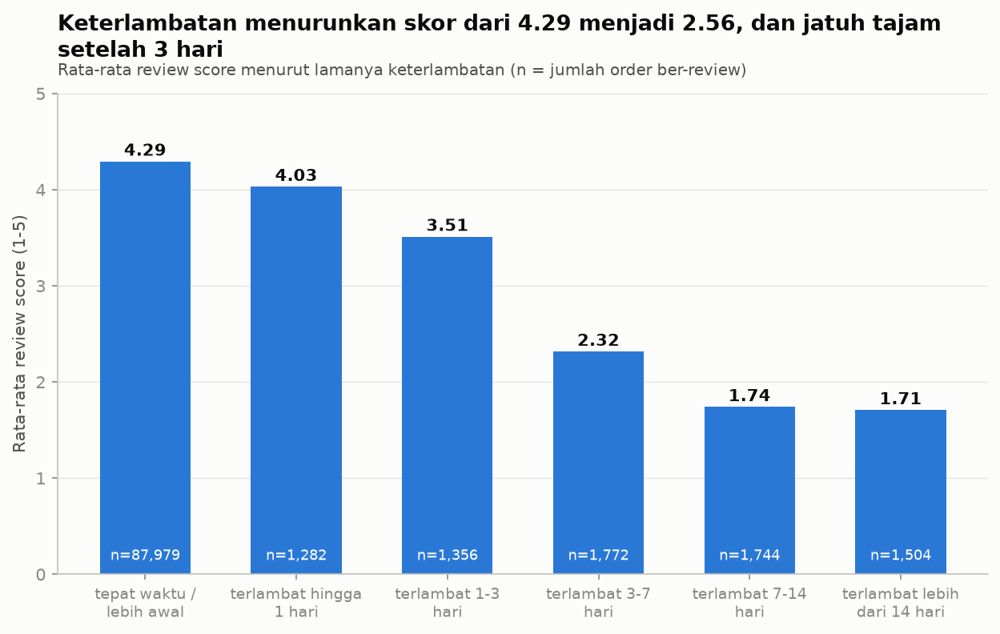

# Olist Customer Satisfaction Analysis

Analisis kepuasan pelanggan dan kinerja bisnis pada
[Brazilian E-Commerce Public Dataset by Olist](https://www.kaggle.com/datasets/olistbr/brazilian-ecommerce)
(99 ribu order, 2016-2018) menggunakan **SQL (DuckDB)** dan **Python**.

**Pertanyaan utama:** apa yang memengaruhi kepuasan pelanggan, dan di mana bisnis bisa memperbaikinya?

## Temuan utama



- **Keterlambatan menurunkan skor review dari 4,29 menjadi 2,57.** Hanya 8% order yang terlambat, tetapi mereka menyumbang sepertiga review bintang 1-2. Skor jatuh tajam setelah keterlambatan 3 hari.
- **Masalah logistik terpusat di wilayah tertentu.** Rio de Janeiro (pasar terbesar kedua) memiliki 13,5% order terlambat dibanding 5,9% di Sao Paulo. AL, MA, CE, dan BA juga jauh di atas rata-rata.
- **Pendapatan tumbuh sekitar 7 kali lipat (Jan 2017 - Agu 2018), lalu mendatar sejak awal 2018.** Puncak terjadi pada Black Friday 2017.
- **Hanya 3,0% pelanggan membeli lagi**, dan skor review order pertama hampir tidak berhubungan dengan itu.
- 10 kategori teratas menyumbang 62% pendapatan tanpa satu kategori dominan.

Laporan lengkap dengan grafik, rekomendasi, dan keterbatasan: **[reports/laporan_temuan.md](reports/laporan_temuan.md)**

Dashboard interaktif (Looker Studio): _tautan menyusul_. Cara membuatnya: [docs/panduan_looker_studio.md](docs/panduan_looker_studio.md). Versi Power BI: [docs/panduan_power_bi.md](docs/panduan_power_bi.md)

## Pertanyaan bisnis yang dijawab

| # | Pertanyaan | Query | Grafik |
|---|---|---|---|
| 1 | Tren pendapatan dan order bulanan + MoM | `sql/05_analisis_bisnis.sql` (Q1) | `fig1_tren_bulanan.png` |
| 2 | Top 10 kategori berdasarkan pendapatan | Q2 | `fig2_top10_kategori.png` |
| 3 | Persentase order terlambat dan distribusinya | Q3a, Q3b | `fig3_distribusi_keterlambatan.png` |
| 4 | Review score tepat waktu vs terlambat (+ uji statistik) | Q4, Q4b | `fig4_skor_vs_keterlambatan.png` |
| 5 | Pendapatan dan keterlambatan per negara bagian | Q5 | `fig5_negara_bagian.png` |
| 6 | Pelanggan dengan lebih dari 1 order | Q6, Q6b | `fig6_pembelian_ulang.png` |

## Proses

1. **Memuat data**: 9 file CSV ke DuckDB (`load_data.py`).
2. **Profiling dan validasi relasi**: baris, tipe, NULL, uji PK/FK (`sql/01`, `sql/02`).
3. **Audit kualitas data**: NULL, review ganda, tanggal tidak logis, kategori tanpa terjemahan, dan keputusan pembersihannya (`sql/03`, `sql/04`, [docs/data_cleaning_log.md](docs/data_cleaning_log.md)). Data mentah tidak pernah diubah, hasilnya disimpan sebagai tabel `clean_*`.
4. **Analisis bisnis**: 6 pertanyaan di atas dengan SQL tanpa duplikasi baris (`sql/05`) dan uji statistik scipy (`src/run_analysis.py`).

## Struktur folder

```
data/           CSV mentah (tidak di-commit, lihat data/README.md)
sql/            01 profiling | 02 relasi | 03 deteksi masalah | 04 tabel bersih | 05 analisis bisnis
src/            run_sql.py | build_clean.py | run_analysis.py | export_for_looker.py
reports/        laporan_temuan.md | tables/ (CSV hasil) | figures/ (grafik)
docs/           data_cleaning_log.md | panduan_looker_studio.md | panduan_power_bi.md
exports/        CSV untuk Looker Studio (tidak di-commit)
load_data.py    memuat CSV ke olist.duckdb
```

## Cara menjalankan

Butuh Python 3.10+. Unduh dataset dari Kaggle dan letakkan file CSV di folder `data/`.

```powershell
python -m venv .venv
.venv\Scripts\Activate.ps1          # macOS/Linux: source .venv/bin/activate
pip install -r requirements.txt

python load_data.py                 # CSV -> olist.duckdb
python src/build_clean.py           # membuat tabel clean_*
python src/run_analysis.py          # hasil query, grafik, uji statistik -> reports/
python src/export_for_looker.py     # (opsional) CSV untuk dashboard Looker Studio
```

Query bisa dijalankan sendiri: `python src/run_sql.py sql/05_analisis_bisnis.sql`

## Teknologi

DuckDB (SQL analitik), Python, pandas, matplotlib, scipy.

## Keterbatasan

Hasil menggambarkan asosiasi, bukan sebab-akibat. Data hanya Sep 2016 - Okt 2018, dan pendapatan tidak termasuk ongkir. Rincian lengkap ada di laporan.
