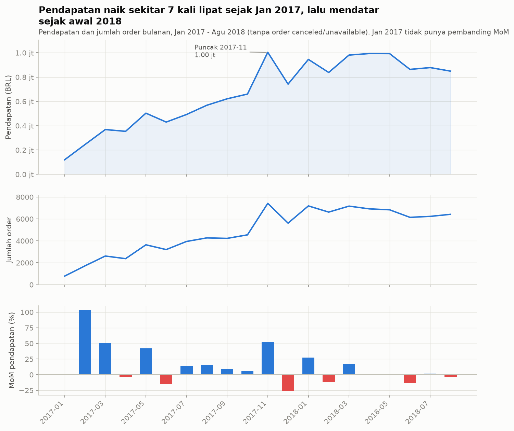
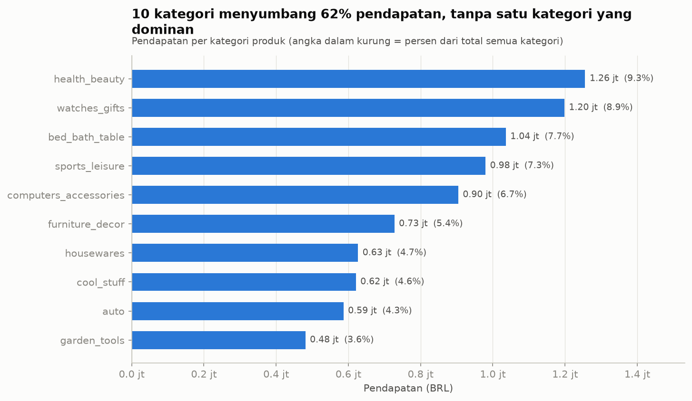
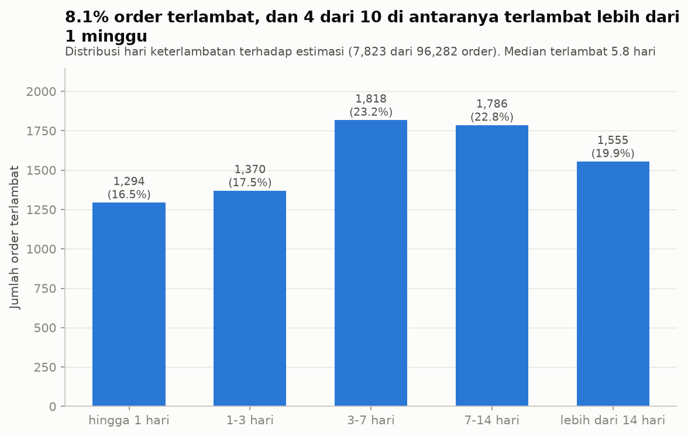
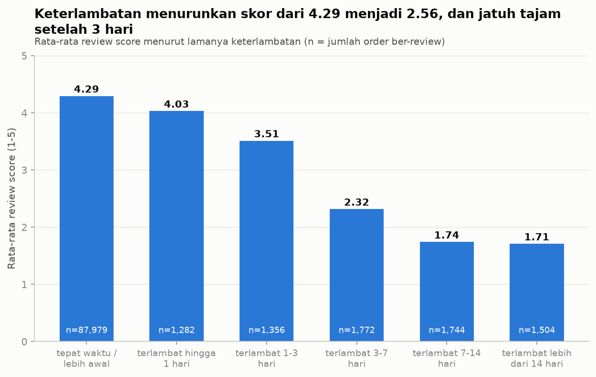
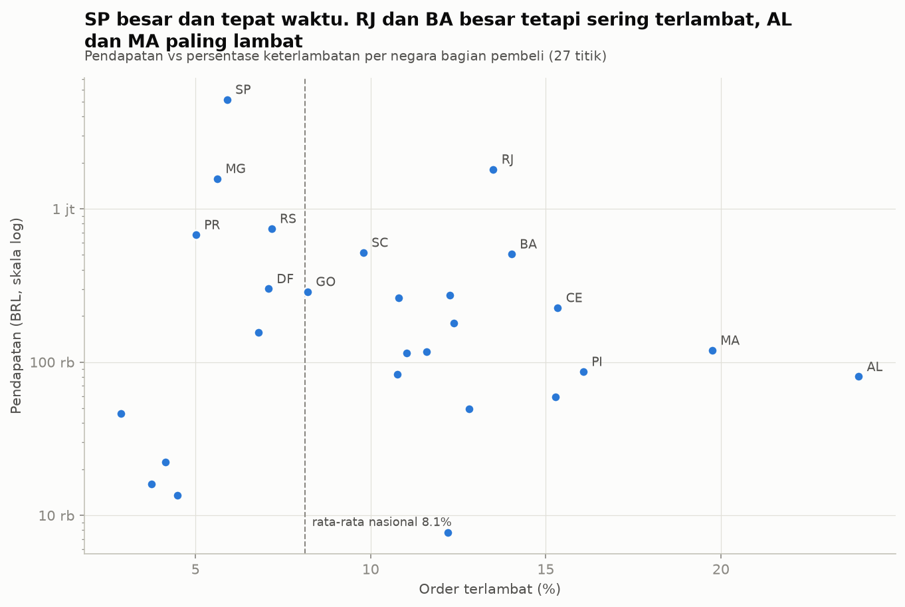
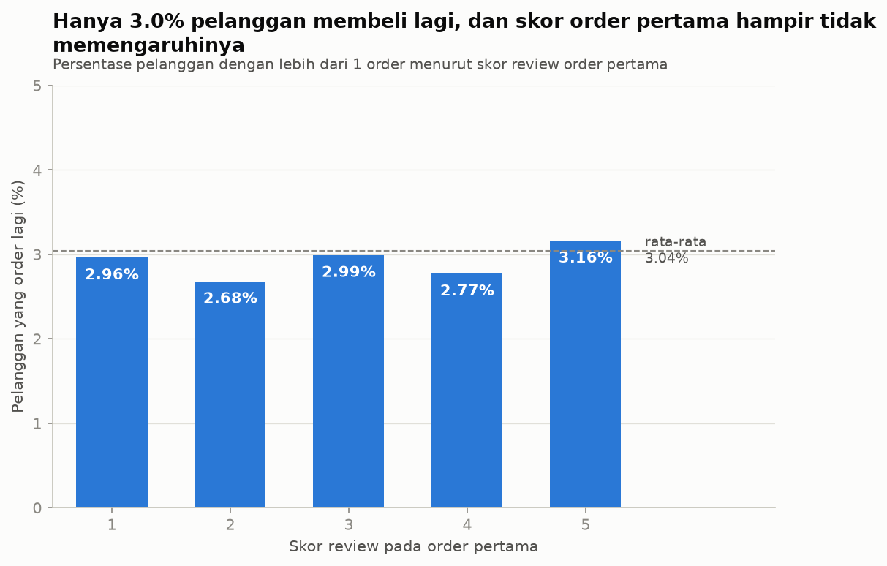

# Laporan Temuan: Kepuasan Pelanggan dan Kinerja Olist

Dataset: [Brazilian E-Commerce Public Dataset by Olist](https://www.kaggle.com/datasets/olistbr/brazilian-ecommerce) (99.441 order, Sep 2016 - Okt 2018, mata uang BRL).
Semua angka dihasilkan oleh `sql/05_analisis_bisnis.sql` dan `src/run_analysis.py`. Tabel mentahnya ada di `reports/tables/`.

## Ringkasan eksekutif

1. **Keterlambatan adalah penentu kepuasan yang paling jelas.** Order terlambat mendapat skor rata-rata **2,57** vs **4,29** untuk order tepat waktu. Hanya 8% order yang terlambat, tetapi mereka menyumbang **sepertiga (33,8%)** dari seluruh review bintang 1-2.
2. **Skor jatuh tajam setelah keterlambatan 3 hari.** Terlambat hingga 1 hari masih 4,03. Terlambat 3-7 hari turun ke 2,32, dan lebih dari 7 hari ke sekitar 1,7.
3. **Masalah logistik terkonsentrasi di wilayah tertentu.** Rio de Janeiro (RJ) adalah pasar terbesar kedua (13,4% pendapatan) tetapi 13,5% ordernya terlambat, lebih dari dua kali lipat SP (5,9%). Bahia (BA) dan Ceara (CE) juga di atas 14%.
4. **Pertumbuhan bisnis kuat tetapi mendatar sejak awal 2018.** Pendapatan bulanan naik sekitar 7 kali lipat dari Jan 2017 ke Agu 2018, lalu stabil di kisaran 0,85-1,0 juta BRL per bulan.
5. **Hanya 3,0% pelanggan membeli lagi**, dan skor review order pertama hampir tidak berhubungan dengan itu (2,7-3,2% di semua skor). Kepuasan saja tidak menjelaskan rendahnya retensi.

## Definisi dan metode

| Hal | Keputusan |
|---|---|
| Order valid | `order_status` bukan `canceled` dan bukan `unavailable` |
| Pendapatan | `SUM(price)` dari `order_items`, **tanpa ongkir** |
| Ruang lingkup pengiriman | `is_analysis_scope`: status `delivered`, tanggal tiba terisi, urutan tanggal logis (96.282 order) |
| Terlambat | tanggal tiba > tanggal estimasi |
| Negara bagian | lokasi **pembeli** (`customers.customer_state`) |
| Bulan pada tren | Jan 2017 - Agu 2018. Bulan lain hanya berisi 2 / 290 / 1 / 1 order, sehingga MoM menyesatkan |
| Pelanggan | `customer_unique_id`, bukan `customer_id` |

Pembersihan data (NULL, duplikat review, tanggal tidak logis, kategori tanpa terjemahan) didokumentasikan di `docs/data_cleaning_log.md`.
Untuk mencegah baris berlipat saat JOIN, metrik level order dihitung di tabel yang sudah satu baris per order, dan metrik level item di-`GROUP BY order` lebih dulu. Total antar-query sudah dicocokkan: pendapatan semua order valid = 13.494.400,74 BRL pada query kategori dan query negara bagian.

---

## 1. Tren pendapatan dan order bulanan



- Jan 2017: 787 order, 120 ribu BRL. Agu 2018: 6.421 order, 849 ribu BRL.
- **Puncak Nov 2017**: 7.421 order dan 1,00 juta BRL (MoM +52,1%), lalu turun 26,1% di Des. Puncak ini berimpit dengan Black Friday: tanggal **24 Nov 2017** memiliki 1.166 order dalam satu hari, tertinggi di seluruh data. Itu penjelasan yang masuk akal, bukan bukti kausal.
- Nilai rata-rata per order stabil di 125-153 BRL, jadi pertumbuhan datang dari **jumlah order**, bukan dari harga.
- Sejak Jan 2018 pendapatan mendatar. MoM berkisar -13% sampai +27% tanpa tren naik lagi.

## 2. Top 10 kategori berdasarkan pendapatan



- 10 kategori menyumbang **62,4%** pendapatan. Tidak ada kategori dominan: yang terbesar, `health_beauty`, hanya 9,3%.
- `watches_gifts` nomor dua dengan hanya 5.604 order karena harga rata-rata per item tinggi (200,70 BRL). `bed_bath_table` nomor tiga tetapi order terbanyak (9.399) dengan harga rata-rata 93,36 BRL.
- Kategori `unknown` (produk tanpa kategori) tidak masuk 10 besar.

## 3. Keterlambatan pengiriman



- **8,13%** order terlambat (7.823 dari 96.282). Median pengiriman 10,2 hari.
- Pada order terlambat: median terlambat 5,8 hari, rata-rata 9,6 hari, maksimum 189 hari.
- **42,7%** order terlambat melewati 7 hari. Ekornya panjang: hampir 1 dari 5 order terlambat lebih dari 14 hari.

## 4. Review score: tepat waktu vs terlambat



| Kelompok | Order ber-review | Rata-rata skor | Skor 1-2 | Skor 5 |
|---|---:|---:|---:|---:|
| Tepat waktu | 87.979 | 4,29 | 9,2% | 62,4% |
| Terlambat | 7.658 | 2,57 | 54,1% | 22,2% |

- Selisih **-1,73 poin**. Uji Mann-Whitney dan Welch menolak "tidak ada beda" dengan p di bawah 1e-300, tetapi yang lebih bermakna adalah ukuran efeknya: **Cohen's d = -1,45** (efek sangat besar).
- Keterlambatan 1-3 hari masih ditoleransi (3,51). Penurunan terbesar terjadi pada 3-7 hari (2,32).
- Ini **asosiasi, bukan bukti sebab-akibat**. Order yang terlambat bisa juga bermasalah dalam hal lain (barang rusak, salah kirim) yang tidak tercatat di data ini.

## 5. Pendapatan dan keterlambatan per negara bagian



| Negara bagian | Pendapatan (BRL) | % total | Terlambat | Median hari kirim |
|---|---:|---:|---:|---:|
| SP | 5.163.867 | 38,3% | 5,9% | 7,2 |
| RJ | 1.811.623 | 13,4% | **13,5%** | 12,0 |
| MG | 1.573.508 | 11,7% | 5,6% | 10,3 |
| RS | 742.560 | 5,5% | 7,2% | 13,2 |
| PR | 676.883 | 5,0% | 5,0% | 10,4 |
| BA | 507.109 | 3,8% | **14,0%** | 16,9 |
| CE | 226.264 | 1,7% | **15,3%** | 18,2 |
| MA | 119.292 | 0,9% | **19,8%** | 19,2 |
| AL | 80.315 | 0,6% | **23,9%** | 22,3 |

- Tiga negara bagian teratas (SP, RJ, MG) menyumbang 63,4% pendapatan. Tabel lengkap 27 negara bagian ada di `reports/tables/q5_per_negara_bagian.csv`.
- **RJ adalah prioritas**: pasar besar dengan keterlambatan jauh di atas rata-rata nasional (8,1%).
- Negara bagian kecil punya sampel kecil, jadi angkanya kurang stabil. Contoh: RR hanya 41 order dalam ruang lingkup, AP 67, AC 80.

## 6. Pelanggan yang membeli lebih dari sekali



- `customer_id` unik per order, sehingga menghitung pelanggan dengan kolom itu akan memberi 0% pembeli ulang. Dengan `customer_unique_id`: **3,04%** (2.888 dari 94.990 pelanggan).
- Hasilnya stabil terhadap definisi order: 3,12% (semua order) dan 3,00% (hanya `delivered`).
- Persentase pembeli ulang menurut skor order pertama: 2,96% / 2,68% / 2,99% / 2,77% / 3,16% untuk skor 1 sampai 5. Uji chi-kuadrat: p = 0,057, **tidak ada bukti kuat** adanya hubungan.

---

## Rekomendasi

1. **Fokus pada keandalan pengiriman di RJ, BA, CE, MA, dan AL.** RJ memberi dampak terbesar karena volume pendapatannya.
2. **Beri peringatan proaktif sebelum keterlambatan melewati 3 hari.** Skor masih relatif aman di bawah 3 hari dan jatuh sesudahnya. Komunikasi dan kompensasi paling efektif di jendela itu.
3. **Perbaiki estimasi pengiriman untuk wilayah jauh.** Median pengiriman ke AL 22 hari dan ke AM sekitar 26 hari. Estimasi yang realistis mengurangi order "terlambat" yang sebenarnya hanya salah estimasi.
4. **Retensi adalah peluang tumbuh terbesar.** 97% pelanggan tidak pernah kembali, dan kepuasan order pertama tidak membedakannya. Perlu ditelusuri faktor lain (harga, ragam produk, program loyalitas).
5. **Pertumbuhan sudah mendatar sejak 2018**, sehingga strategi perlu bergeser dari akuisisi volume ke nilai per pelanggan.

## Keterbatasan

- Data hanya Sep 2016 - Okt 2018 dan bukan seluruh pasar Brasil. Temuan menggambarkan Olist pada periode itu.
- Hasil di atas adalah **asosiasi**. Tidak ada eksperimen yang bisa membuktikan sebab-akibat.
- Review bersifat sukarela: 99,3% order dalam ruang lingkup punya review, tetapi pelanggan yang menulis komentar (41% dari review) belum tentu mewakili semua.
- Pelanggan yang order pertamanya mendekati akhir data punya waktu lebih pendek untuk membeli lagi, sehingga angka pembeli ulang cenderung terlalu rendah. Pola per skor tetap bisa dibandingkan karena bias itu berlaku sama pada semua skor.
- Pendapatan tidak termasuk ongkir. Memasukkannya akan menaikkan angka tetapi tidak mengubah pola.
- Keputusan pembersihan data (misalnya 1 review per order, yang terbaru) diuji dampaknya hanya secara deskriptif di `docs/data_cleaning_log.md`.

## Cara mereproduksi

```
python load_data.py
python src/build_clean.py
python src/run_analysis.py
```
